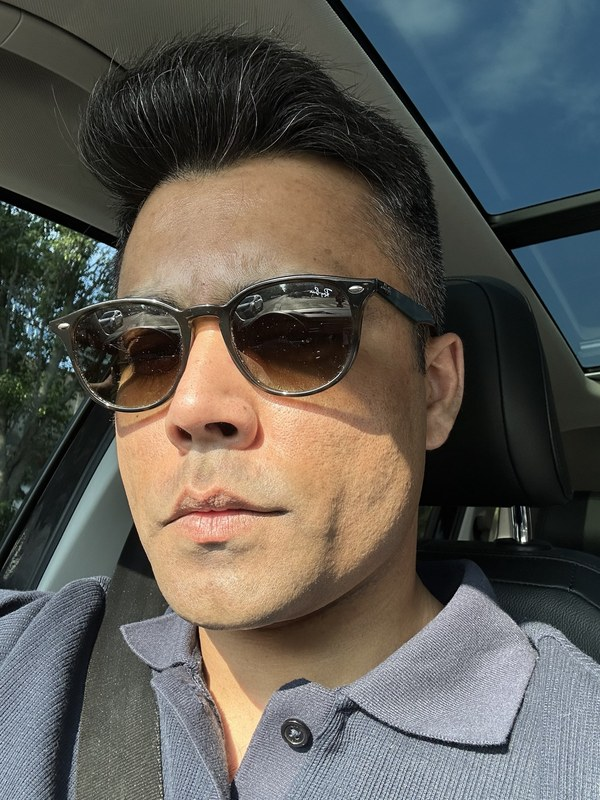

# 👋 Hi, I'm Daniyal Ajmi

**Automation Expert · Agentic AI · Robotics**

Ex-Honda · Ex-Tesla · Current Rivianite

I'm an automation expert with more than ten years in industrial automation, now building AI agents that help
engineers understand and safely change real machines.

A production machine is rarely one system: the PLC comes from one vendor, the robot from another, the mobile robot
from a third, each with its own tools. I build software that reads all of it as one machine, answers questions with
the evidence, and tests every change on a digital twin before anything is written.

I'm especially interested in:

* 🏭 Industrial automation: PLCs (Beckhoff TwinCAT, IEC 61131-3 Structured Text) and how machines fit together
* 🤖 Robotics: Universal Robots arms and ROS 2 mobile robots
* 🧠 Agentic AI: tool-using agents, retrieval over code and graphs, tree-of-thought planning
* 🧪 Digital twins and simulation-first verification
* 🛡️ Human-in-the-loop safety: the model proposes, code checks, the twin tests, a person decides

## Current focus

* **Axiom**, an engineering agent for multi-vendor machines (my CMU Agentic AI capstone): one vendor-neutral graph
  of the machine, answers that cite the code, diagnosis of why a run stopped, and changes tested on TwinCAT, URSim,
  ROS 2 and a 3D plant simulation before an engineer approves them
* Guardrails in code rather than in prompts, and evaluation with honest held-out sets
* Lossless write-back into vendors' own project files

## Outside work

🥋 Jiu-jitsu player · ☕ coffee lover · 🐈 owner of British Shorthairs · 🔴 Arsenal supporter · ✈️ traveler and
explorer

## Contact

💼 LinkedIn: [linkedin.com/in/daniyal-ajmi-b381506a](https://www.linkedin.com/in/daniyal-ajmi-b381506a)
